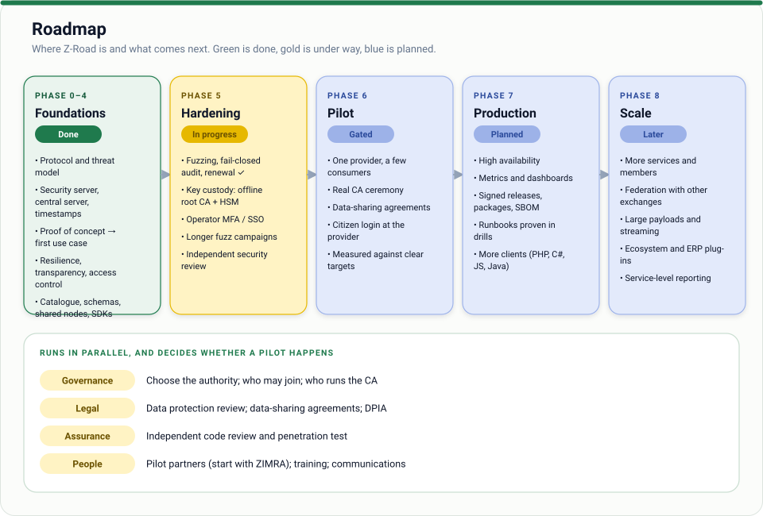

# Z-Road

**A secure data exchange layer for Zimbabwe, written in Rust.**

Z-Road lets government agencies, banks, companies and other organisations query each other's data directly, safely and with a full audit trail, without anyone building a single central database. It is inspired by Estonia's [X-Road](https://x-road.global/) and designed around the realities of Zimbabwe: patchy connectivity, power cuts, modest hardware and the need for public trust.

> **Status: working proof of concept.** The protocol, security server, central server, timestamp authority and a first use case run end to end and are covered by automated tests. It has **not** had an independent security review and is **not** ready for real data. See the [Roadmap](#roadmap) and the [threat model](docs/threat-model.md).

---

## Table of contents

- [Why Z-Road](#why-z-road)
- [Core ideas](#core-ideas)
- [Architecture](#architecture)
- [How a request flows](#how-a-request-flows)
- [Worked example: tax clearance check](#worked-example-tax-clearance-check)
- [Joining the network](#joining-the-network)
- [Zimbabwe-specific design considerations](#zimbabwe-specific-design-considerations)
- [Why Rust](#why-rust)
- [Repository layout](#repository-layout)
- [Getting started](#getting-started)
- [What works today](#what-works-today)
- [Roadmap](#roadmap)
- [Documentation](#documentation)
- [Contributing](#contributing)
- [Acknowledgements](#acknowledgements)
- [License](#license)

---

## Why Z-Road

Today, proving something to another organisation in Zimbabwe usually means a PDF, a stamped letter or an email attachment. A supplier's tax clearance certificate, a proof of address, a company registration extract: each one is easy to forge, easy to let expire and slow to verify.

Z-Road replaces "send me a document" with "ask the source, get a signed answer":

- **Once-only data.** The state and its partners ask the owner of the data, not the citizen, for information that already exists.
- **Fast, verifiable services.** Pre-filled forms, instant KYC, live tax clearance checks.
- **Transparency.** Every query is logged, so people can eventually see who accessed their data and when.
- **No honeypot.** Each organisation keeps its own data. There is no central database to breach or abuse.

## Core ideas

| Principle | What it means |
| --- | --- |
| **Decentralised data** | Data stays with its owner. Z-Road only carries requests and answers. |
| **Signed and logged** | Every message is signed, timestamped and logged on both sides, so exchanges are provable later. |
| **Provider decides access** | The central authority vouches for *who you are*. The data provider decides *who may use its services*. |
| **Minimal answers** | Services answer the question asked ("is this TIN cleared?") and nothing more. |
| **Per-service permissions** | Access is granted per service, not per organisation. |
| **Open source** | The protocol and software are open for audit and independent implementation. |

## Architecture

Z-Road has three kinds of components.

<p align="center">
  
</p>

- **Security Server.** Runs at every member. It signs, encrypts, timestamps and logs messages, checks access rights and forwards requests to the internal system. This is the main piece of software and where most security-critical code lives.
- **Central Server.** Run by the governing authority. It keeps the list of members and their services and acts as the trust anchor. It does **not** see or store exchanged data.
- **Timestamp Service.** Provides trusted timestamps so that a signed exchange can be proven to have happened at a specific time.

An organisation's internal systems never talk to another organisation directly. Only security servers talk to each other.

### Addressing

Every participant and service is identified by a path:

```
instance / member-class / member-code / subsystem [/ service / version]
```

For example `ZW/GOV/ZIMRA/tax-clearance/verify/v1`.

## How a request flows

<p align="center">
  
</p>

Both sides keep their own logs, so either party can later prove what was asked and answered.

## Worked example: tax clearance check

Buyers in Zimbabwe regularly need to confirm that a supplier holds a valid ITF263 tax clearance before paying them. Today that is a PDF sent by email. With Z-Road:

1. A clerk at the buyer enters a supplier invoice. The ERP calls the buyer's security server with the supplier's TIN.
2. The buyer's security server signs and logs the request and sends it over mTLS to ZIMRA's security server.
3. ZIMRA's security server confirms the buyer is a registered member and is allowed to use the clearance service.
4. ZIMRA's system looks up the TIN and replies. The reply is signed, so the buyer can prove later that ZIMRA confirmed the supplier was cleared on that date.

Request:

```http
POST /r1/ZW/GOV/ZIMRA/tax-clearance/verify/v1
Z-Road-Client: ZW/COM/12345678/accounts-payable
Z-Road-Id: 7f3c9a1e-...

{ "tin": "2000123456" }
```

Response:

```json
{
  "tin": "2000123456",
  "name": "Supplier (Pvt) Ltd",
  "status": "VALID",
  "valid_until": "2026-12-31"
}
```

Design notes:

- **Answer the question, not more.** The service returns status and expiry only, with no turnover or tax history. This data minimisation is what makes it reasonable to open the service to every member.
- **Live check beats a PDF.** The buyer can re-check before every payment instead of trusting a certificate that may have been revoked last week.
- **Shared nodes for small businesses.** One security server can host many members, so an accounting vendor, bank or chamber of commerce can run a node on behalf of customers.

## Joining the network

<p align="center">
  
</p>

The authority vouches for identity. Each provider independently decides who may use each of its services. The Registrar General, for instance, decides whether ZIMRA can query the ID register.

## Zimbabwe-specific design considerations

- **Legal footing.** The Cyber and Data Protection Act and the role of POTRAZ as data protection authority shape what can be exchanged, logged and retained. Legal review is a prerequisite for any real deployment.
- **First adopters.** The Registrar General (national IDs, births), ZIMRA, and banks or mobile money operators (KYC) offer the quickest real-world wins.
- **Unreliable connectivity and power.** Security servers should queue, retry and resume gracefully rather than assume they are always online.
- **Modest hardware.** District offices may run nodes on small machines, so resource use matters.
- **Citizen visibility.** Letting people see who accessed their data is central to public trust and should be designed in from the start, not added later.

## Why Rust

The security server sits at the edge of every organisation and must be hard to break.

- Memory safety without a garbage collector.
- Low memory and CPU footprint.
- Strong ecosystem for the job: `tokio` and `axum` for networking, `rustls` for mTLS, `ring` or `aws-lc-rs` for cryptography, `serde` for message formats.
- Single static binaries are easy to deploy on constrained machines.

## Repository layout

A single Cargo workspace, so the protocol code is shared and end-to-end tests are simple. It can be split later if separate owners or release cycles emerge.

```
z-road/
  crates/
    zroad-core/         identifiers, signed messages, PKI helpers, hash-chained audit log
    zroad-net/          mutual TLS, small HTTP client, server with peer certificates, central API client
    security-server/    the main binary: provider and consumer sides, outbox, audit anchoring
    central-server/     certificate authority and member directory
    timestamp-service/  trusted timestamps for audit log anchoring
    zroad-client/       Rust client library for integrating applications
    signer-service/     lets a hosted member keep its own signing key on its own machine
    zroad-cli/          admin and audit tool: enrol, revoke, verify logs and proofs, citizen access log
    e2e-tests/          whole-network tests over real mutual TLS
  examples/
    zimra-clearance/    mock provider system (tax clearance check)
    buyer-client/       sample consumer
    citizen-portal/     demo "who looked at my data?" page
  scripts/demo.sh       run a complete local network and make a signed, logged request
  Dockerfile, deploy/   container image, a Docker Compose network, systemd units, smoke tests
  docs/                 protocol, threat model, deployment, legal considerations, pilot plan
```

## Getting started

You need a recent stable Rust toolchain.

```sh
cargo test --workspace      # unit and end-to-end tests
scripts/demo.sh             # a full local network, step by step
docker compose -f deploy/docker-compose.yml up --build --wait   # the same, in containers
```

The demo starts a central server, a timestamp authority, a mock ZIMRA clearance system and two security servers, then:

1. a buyer checks a supplier's tax clearance (`VALID`), and another that is `EXPIRED`;
2. the signed proof of the exchange is verified offline;
3. ZIMRA's log is queried for who looked up that TIN (the citizen's view), also as a web page on http://127.0.0.1:9100;
4. the audit log is verified, including its trusted timestamp.

See [docs/deployment.md](docs/deployment.md) for setting up a network by hand and the configuration reference.

## What works today

| Area | Implemented |
| --- | --- |
| Identity | Private CA; Ed25519 member keys; enrolment with one-time tokens; automatic renewal everywhere a key lives (security servers, nodes, signers, timestamp authority, central server), switched in without a restart or dropped calls, with old proofs and anchors still verifiable; certificate subject always the member id |
| Transport | Mutual TLS between security servers (`rustls`, `ring`) |
| Messages | Signed requests and responses, bound together by hash; body hashes; ±5 minute clock window |
| Access control | Per-service, default-deny rules evaluated by the provider; revocation through the directory |
| Replay and retries | Per-peer message id cache (rebuilt from the audit log after a restart); identical retries are idempotent |
| Integration | Plain-HTTP internal API ([OpenAPI](docs/openapi-internal.yaml)), a Rust client library with typed errors, async submit-and-wait and offline proof verification ([guide](docs/integration.md)) |
| Discovery and contracts | A public service catalogue with a JSON Schema per service request and answer; providers enforce them before anything reaches their system, consumers can check early; access rules stay private |
| Shared nodes | One security server can host many members with separate logs, tokens and rules ([deployment guide](docs/deployment.md#shared-nodes)). Operator-held keys, or **member-held keys**: each hosted member signs with its own key in a signer service on its own machine, and the node cannot forge its messages ([guide](docs/deployment.md#member-held-keys-on-a-shared-node)) |
| Resilience | Durable async outbox with backoff; cached directory keeps working if the central server is down |
| Accountability | Hash-chained audit log on both sides, refuses to start on a broken chain, periodic trusted-timestamp anchors |
| Proofs | A signed proof header on every answer, verifiable offline with `zroad-cli proof-verify` |
| Transparency | Provider-side "who looked up this subject" query, without storing the subject in clear; a citizen endpoint that answers only for the person a login system has vouched for (signed identity assertions) |
| Access control | Named operators with roles (`auditor`, `operator`, `admin`, `portal`) and per-person tokens stored as hashes; every privileged action is recorded in the tamper-evident log before it happens ([details](docs/access-control.md)) |

## Roadmap



The full plan, with status per item and the **gate for starting a pilot**, is in
[ROADMAP.md](ROADMAP.md). In short:

- [x] **Phases 0–4: foundations.** Protocol and threat model; security server, central server and timestamp authority; first use case (ZIMRA tax clearance); resilience; transparency and citizen login; access control with roles; service catalogue with schemas; shared nodes with member-held keys; automatic renewal; clients for Rust and Python; packaging; [guides](guides/README.md).
- [~] **Phase 5: hardening.** Done: fuzzing, fail-closed audit logging, replay protection across restarts, renewal, `cargo audit`, adversarial tests. **Next:** key custody (offline root CA with an HSM or hardware token), the independent security review, operator MFA, a real citizen login at the first provider, longer fuzz campaigns.
- [ ] **Phase 6: pilot.** Gated on an accountable authority, legal review and data-sharing agreements, the independent review, and rehearsed runbooks.
- [ ] **Phase 7: production readiness.** High availability, metrics, signed packages, quotas, more client libraries.
- [ ] **Phase 8: scale.** More members and services, federation, large payloads, ecosystem.

What decides whether a pilot happens is mostly outside the code: governance, legal, assurance and people. See [ROADMAP.md](ROADMAP.md#outside-the-code-decides-whether-any-of-this-is-used).

## Documentation

**Start with the [guides](guides/README.md)**: how to deploy securely, a separate guide for every kind of user, how to build an SDK, operations, incident response and troubleshooting. The reference documents:

- [Protocol specification](docs/protocol.md)
- [Threat model](docs/threat-model.md)
- [Running Z-Road](docs/deployment.md)
- [Packaging: Docker Compose and systemd](docs/packaging.md)
- [Access control: operators, roles and citizen login](docs/access-control.md)
- [Integrating an application](docs/integration.md) and the [internal API (OpenAPI)](docs/openapi-internal.yaml)
- [Legal and regulatory considerations](docs/legal-considerations.md)
- [Pilot plan](docs/pilot-plan.md)
- [Design note: shared security servers](docs/design/shared-nodes.md) (implemented)
- [Security policy](SECURITY.md) and [contributing guide](CONTRIBUTING.md)

## Contributing

Ideas, critique and contributions are welcome at this early stage, particularly on:

- Zimbabwean legal and regulatory requirements
- Protocol and threat-model review
- Rust implementation
- Real-world use cases and pilot partners

Open an issue to start a discussion. Before sending code, run `cargo fmt --all`, `cargo clippy --workspace --all-targets -- -D warnings` and `cargo test --workspace`.

## Acknowledgements

Z-Road is inspired by [X-Road](https://x-road.global/), developed in Estonia and now maintained by the Nordic Institute for Interoperability Solutions (NIIS). Z-Road is an independent project and is not affiliated with X-Road or NIIS.

## License

[MIT](LICENSE). Copyright (c) 2026 Victor Phos. Contributions are accepted under the same licence.
