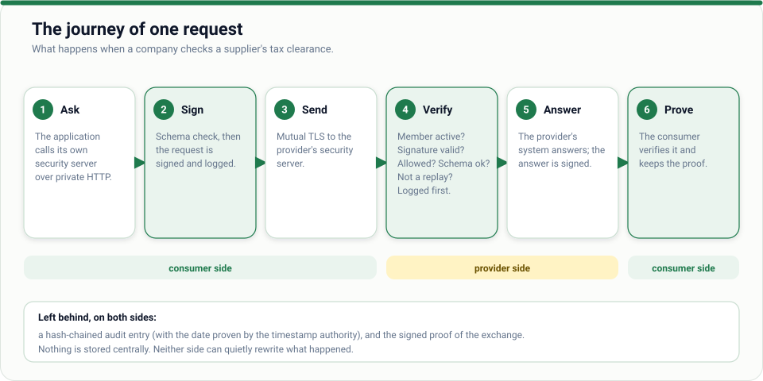
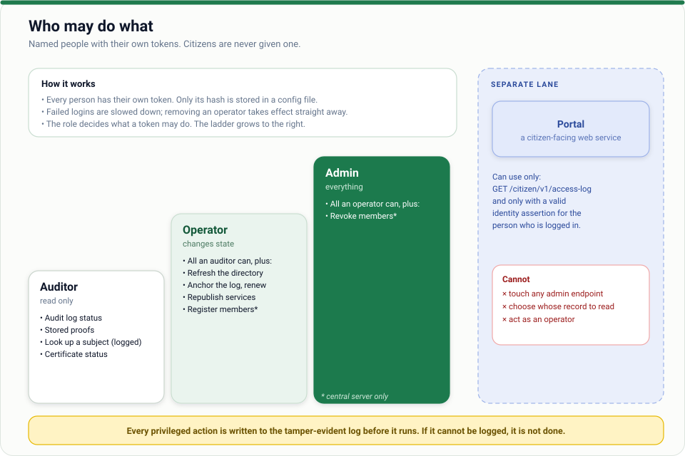
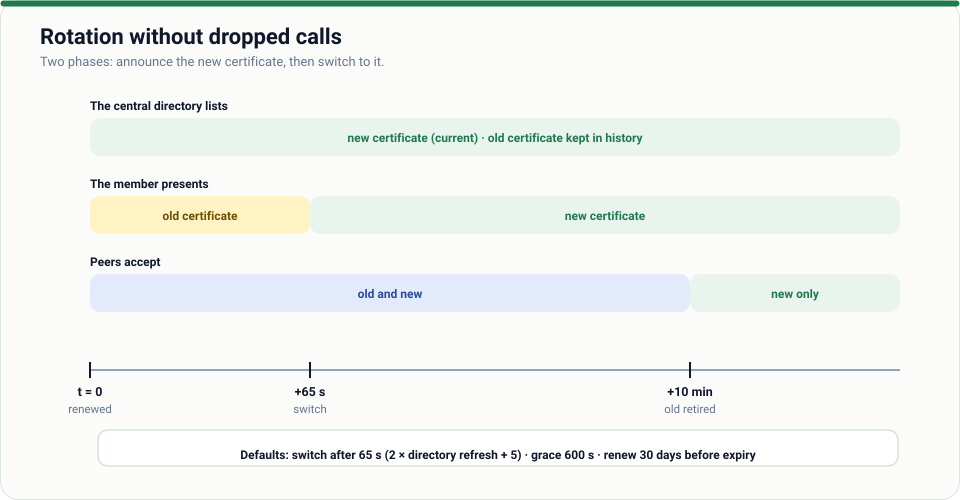

# 00 · How Z-Road works

*For anyone. No technical background needed for the first half.*

## The problem

Today, proving something to another organisation usually means a document: a stamped letter,
a PDF by email, a photocopy. A supplier's tax clearance certificate, a proof of address, a
company registration extract. Each one is easy to forge, easy to let expire, and slow to
check. Organisations also keep asking citizens for information the state already holds.

## The idea

**Ask the source, get a signed answer.**

Instead of passing documents around, organisations ask each other directly, and every
question and answer is signed, logged and provable. There is **no central database**:
each organisation keeps its own data and only the question and the answer travel.

## The cast

| Who | What they do |
| --- | --- |
| **Authority** | Runs the *central server* (it issues each organisation's identity and keeps the member list) and the *timestamp authority* (it dates the logs). It never sees the data exchanged. |
| **Provider** | An organisation that offers a **service** from its own systems, for example "is this tax number cleared?". It decides who may use each service. |
| **Consumer** | An organisation whose software asks providers questions. |
| **Security server** | A program every organisation runs. It signs, checks and logs everything and talks to other organisations. Your own systems only ever talk to *your* security server. |
| **Citizen** | A person whose data is held. They can see *who looked at their record*. |
| **Shared node** | A vendor that runs a security server for several small organisations. |
| **Auditor** | Anyone who verifies logs and proofs. They need no special access to the network. |

## Identity: who are you really?

Every organisation has a **member id** such as `ZW/GOV/ZIMRA` (country / class / code) and a
**certificate**: a digital identity card issued by the authority and bound to that id. When two
security servers connect, each proves who it is with its certificate. Nobody can pretend to
be ZIMRA without ZIMRA's private key.

## The life of a request

1. A company's accounting software asks its **own** security server: "is TIN 2000123456 cleared?"
2. The security server checks the question against the service's published format, signs it
   and writes it to its log.
3. It sends the signed question to ZIMRA's security server over an encrypted, mutually
   authenticated connection.
4. ZIMRA's security server checks that the asker is a current member, that the signature is
   genuine, that this member may use this service, that the question is well-formed, and that it
   is not a replay. It **writes the question to its own log first**, then passes it to ZIMRA's system.
5. ZIMRA's system answers. The answer is signed.
6. The company's security server verifies the answer and gives the software the result plus a
   **proof**: the signed question and signed answer together.

Months later, the company can show the proof to anyone. Anyone with the member list can verify
it, offline, without asking ZIMRA. That is the difference between "I saw it on a screen" and
"I can prove it".

## What gets recorded

- **Audit logs.** Each security server keeps a log in which every entry includes a fingerprint of the
  one before it, so removing or editing an entry breaks the chain and is detected. Every privileged
  action by an operator is recorded *before* it is performed.
- **Trusted dates.** Every minute or so a security server asks the timestamp authority to sign the
  current end of its log. That proves the log existed in that state at that time, so history cannot
  be quietly rewritten later.
- **Proofs.** Each exchange yields a signed proof the consumer can keep.

## Who may see what

- **Providers decide who may use each service.** By default nobody may. Rules say, for example,
  "any registered company may check tax clearance", but only government bodies may fetch a full
  return.
- **Services answer the question, not more.** A clearance check returns status and expiry, never
  turnover. Providers publish a precise format (a JSON Schema) for each request and answer, and the
  security server rejects anything that does not match before it reaches the provider's system.
- **Operators** have named accounts with roles: auditor (read-only), operator (can change things),
  admin. Everything they do is logged.
- **Citizens** are never given a login to Z-Road. A citizen-facing page asks on their behalf, and
  can only see *that* citizen's record, because the provider's own login system vouches for who
  they are. See [Citizen](users/citizen.md).

## Staying up when things break

- If a provider is down, a consumer can **queue** the request. The security server keeps it on disk
  and retries with growing pauses, safely: a repeated request is recognised and answered once.
- If the central server is down, security servers keep working from their last copy of the member list.
- If a security server restarts, it remembers recent requests so nothing is accepted twice.

## Small organisations: shared nodes

Not everyone can run a server. A vendor (an accounting software company, a bank) can run a
**shared node** that carries traffic for many small members. The members can still keep their
own signing keys on their own machines, so the vendor can carry their messages but cannot
forge them.

## Keys: the things that must stay secret

The most valuable secret is the authority's **root CA key**: whoever holds it can create an identity
for anyone. It belongs offline or in a hardware security module (HSM), a tamper-resistant device that
signs without ever revealing the key. Every other key matters too, but a stolen member key harms one
organisation, and revoking it fixes it. See [Deploy securely](02-deploy-securely.md).

Certificates are renewed automatically, without downtime, in two phases:

## What Z-Road is not

- **Not a central database.** There is nothing to hack in one place, and nothing to subpoena in one place.
- **Not a decision about what may legally be shared.** That is law and policy; Z-Road enforces the
  decision you make, per service, and records it. See the [legal checklist](../docs/legal-considerations.md).
- **Not a payment or messaging system.** It carries signed requests and answers between systems.
- **Not magic against a malicious provider.** It proves *what a provider said*, not that it was true.

## Where next

| You are… | Read |
| --- | --- |
| Curious | [Quickstart](01-quickstart.md): run it in ten minutes |
| Deciding | [Decision-maker guide](users/decision-maker.md) |
| Deploying | [Deploy securely](02-deploy-securely.md) |
| Building | [Consumer developer](users/consumer-developer.md) · [Building a service](03-building-a-service.md) |
| Looking for a word | [Glossary](09-glossary.md) |
