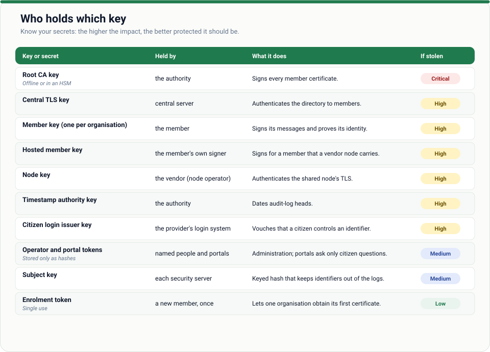

# 06 · Incident response

*For when something has gone wrong, or might have. Read it **before** you need it, then print the
triage picture.*


## The five rules

1. **Contain first, investigate second.** Stop the damage, then work out what happened.
2. **Preserve the evidence.** Copy `audit/`, `proofs/` and the journal before you change anything.
3. **Tell the authority early.** Revocation is the authority's lever, and it is quick.
4. **Rotate everything that could have been seen**, not only the thing you know was.
5. **Write it down as you go.** Times, commands, decisions.

## Quick reference

| Situation | Severity | First move |
| --- | --- | --- |
| A member's private key may be stolen | **High** | Ask the authority to revoke now; re-enrol after |
| An operator token leaked | **High** | Remove it from the config, restart, rotate others, review `Admin` entries |
| `internal_token` leaked, or the internal listener was exposed | **High** | Rotate the token, bind to a private address, review who called |
| Audit log fails verification | **High** | Stop trusting that node's log; keep a copy; restore from backup |
| The CA key (`ca.key`) may be exposed | **Critical** | Start a new network CA: see below |
| A signer service machine is compromised | **High** | Revoke the member, rotate its key |
| A hosted member's node is compromised | **Medium to High** | The member's key is safe (kept elsewhere) but its traffic was visible: tell the member, review the log |
| A provider's upstream system is down | Low | Callers see `upstream_unavailable`; fix the upstream |
| Unexpected spike in calls | Medium | Look at who: `rate_limited` entries and the log |

## Playbooks

### A · A member's key may be stolen



A stolen member key means someone can pose as that member **until it is revoked**.

1. **Contain**: the authority revokes the member (final):

   ```sh
   zroad-cli member-revoke --central https://central.example.zw:8443 --ca ca.pem \
     --admin-token-file admin.token --id ZW/COM/12345678
   ```

   Peers stop accepting that identity as they refresh the directory (within the refresh interval).
   Providers can also remove the member from their `[[access]]` rules and restart to cut it off at once.
2. **Preserve** the member's `audit/` and the providers' logs for the period of exposure.
3. **Investigate**: on each provider, find that member's exchanges in the window:
   `zroad-cli audit-verify` first, then read the entries. Compare to what the member says it sent.
4. **Recover**: the member gets a **new** enrolment token (revocation is final for the old id, so it is registered afresh) and re-enrols on a clean machine.
5. **Report**: if citizens' data was reached, follow your legal duties ([legal considerations](../docs/legal-considerations.md)).

### B · An operator token leaked

1. Delete the `[[operators]]` entry and restart (this ends that token immediately).
2. Create a replacement with `zroad-cli operator-token`.
3. Read the log's `Admin` entries since the leak: they name the operator for each action.
4. If it was an **admin**, treat everything they could change (access rules, catalogue) as suspect.

### C · The internal listener was exposed

Anything that could reach it could act as your applications.

1. Rebind `internal_listen` to a private address, set a new `internal_token`, restart.
2. Check the log for exchanges you did not expect (`Exchange` entries with `via` and the `Z-Road-Client`).
3. Treat data returned in that window as disclosed.

### D · The audit log fails verification

`zroad-cli audit-verify --log … --directory …` reports the first broken entry. A broken chain means
an entry was changed, removed or reordered, or the disk is damaged.

1. Copy the whole `audit/` folder away. **Do not edit it.**
2. Find the last good timestamp anchor: everything before it is independently provable.
3. Restore from backup onto a clean machine if the node must keep serving; the node refuses to start on a corrupt log by design.
4. Other parties' logs contain their side of the same exchanges: ask them for theirs.

### E · The CA key may be exposed (authority)

This is the worst case: the attacker can mint identities.

1. Take the central server offline. Tell every member out of band.
2. Create a **new** CA (`central-server init` on a clean machine, ideally with the key in an HSM or token once that is supported: see the [roadmap](../ROADMAP.md)).
3. Re-enrol every member under the new CA and distribute the new `ca.pem` through a trusted channel.
4. Keep the old logs: proofs made under the old CA remain checkable against the old CA certificate.

CA rotation without a full re-enrolment is on the roadmap; today this is a rebuild, so protect `ca.key`.

### F · A signer service machine is compromised (hosted member)

The signer holds the member's key. Treat it like playbook A: revoke, re-enrol on a clean machine.
Also review what the signer signed: the node's audit log records every exchange made with that key.

## After the incident

- [ ] Timeline written and shared with the authority
- [ ] Root cause found; one change that would have prevented or shortened it
- [ ] Secrets rotated; access reviewed
- [ ] Monitoring added for the signal you missed
- [ ] This guide updated

## Next

[Troubleshooting](07-troubleshooting.md) · [Threat model](../docs/threat-model.md) ·
[SECURITY.md](../SECURITY.md) to report a vulnerability in Z-Road itself
