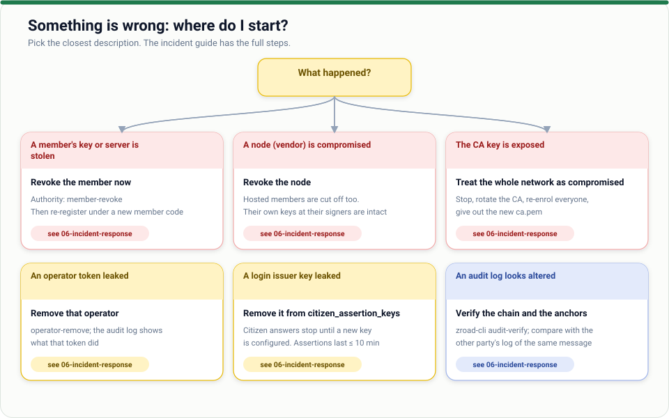

# 07 · Troubleshooting

*Find the message you are seeing, learn what it means, fix it.*

Every error Z-Road itself produces carries a header `Z-Road-Error: <code>` and a JSON body
`{"error": "<code>", "message": "…"}`. A response **without** that header is the provider's own answer
(even a 404 or 403). If a call fails with `Retry-After`, it is worth retrying.

## 1 · Start here

| Symptom | First thing to check |
| --- | --- |
| Cannot reach your own security server | Is the service running? `systemctl status zroad-security-server@NAME`; is the internal address and port right? |
| Calls fail with `unknown_provider` | The provider is not in your directory: is the id spelled exactly (`ZW/GOV/ZIMRA`)? Refresh: `POST /admin/v1/directory/refresh` |
| Calls fail with `provider_unreachable` | The provider's endpoint is down, blocked by a firewall, or its DNS is wrong |
| `access_denied` | The provider has not allowed you for that service. Ask the provider; this is not a fault |
| Server will not start | Run `security-server check-config --config …` and read the first error |
| Everything worked yesterday | Certificate expired? `GET /admin/v1/identity` → `certificate_days_left` |

## 2 · Errors you see as a **caller** (from your own security server)

| Code | Meaning | What to do |
| --- | --- | --- |
| `invalid_request` | Your call is malformed: bad service path, bad client id, or you claimed a subsystem that is not yours | Fix the request. The path is `/r1/<instance>/<class>/<code>/<subsystem>/<service>/<version>` |
| `unknown_provider` (404) | Provider not in the directory | Check spelling; refresh the directory |
| `provider_unreachable` (503, retry) | Cannot connect to the provider | Retry later; contact the provider if it persists |
| `bad_response` (502) | The provider's reply failed validation (signature, binding to your request) | Do not trust it. Report it to the provider and the authority |
| `schema_violation` (400) | Your request does not match the service's published schema | Fix the body; read the message, it names the field |
| `signer_unavailable` (503, retry) | Your security server cannot reach the signer service that holds your key | Start or fix the signer service (hosted members) |
| `audit_unavailable` (503, retry) | Your security server cannot write its audit log | Check disk space and permissions; the node stops by design rather than act unlogged |

## 3 · Errors a **provider** returns to a caller

| Code | Meaning | What to do |
| --- | --- | --- |
| `access_denied` | The caller is a valid member but not allowed for this service | Provider adds an `[[access]]` rule if it should be allowed |
| `unsupported_media_type` | Content type not accepted by the service | Send what the service declares (usually `application/json`) |
| `schema_violation` | Request body does not match the schema | Caller fixes the body |
| `upstream_schema_violation` | The provider's own system returned something that breaks the published response schema | Provider's problem: fix the upstream or the schema |
| `upstream_unavailable` | The provider's internal system is down | Provider fixes it; callers retry or use the queue |
| `unknown_service` | No such service or version at this provider | Check the catalogue: `zroad-cli catalogue …` |
| `unsupported_version` / `stale_or_unsupported` | Protocol or message version not supported | Update the software |
| `rate_limited` (retry) | Too many calls from this member | Back off; the provider can raise the limit |
| `too_large` | Body exceeds the limit | Send less, or ask the provider to raise it |
| `hosted_member_must_use_node` | A hosted member connected directly instead of through its node | It must send via its node's identity |
| `not_the_node`, `hosting_mismatch` | A hosted-member call arrived at the wrong node, or the registration says a different node hosts it | Check `hosted_by` in the member's registration |

## 4 · Why a message was refused (verification failures)

| Code | Meaning | What to do |
| --- | --- | --- |
| `bad_signature` | The signature does not match the sender's known key | Often a key just rotated: refresh the directory and retry. If it persists, suspect tampering or an old key |
| `body_mismatch` | The body does not match the hash in the signed message | Something altered the body (a proxy?). Make sure nothing in the path rewrites it |
| `client_mismatch` | The client named in the message is not the authenticated peer | A member claiming to be another; or a node mislabelling hosted traffic |
| `wrong_provider` | The message was addressed to a different provider | Check the service path |
| `stale_request` | Timestamp outside the allowed window | Fix the clock: run NTP on every machine |
| `replay` | A message id was seen before with different content | A bug or an attack; never reuse a message id |
| `already_processed` | The same request was received before and its answer is returned | Normal for a retry after a restart or timeout; the original answer is the answer |
| `in_flight` / `busy` | The original of this request is still being processed | Wait and retry |
| `not_our_request`, `not_our_response` | The reply is not bound to this node's request | Report it; do not trust it |
| `unsupported_domain` | A signature was made for a different purpose (domain separation) | Software mismatch: update |
| `malformed` | The envelope is not valid | A broken client or something altering the message |

## 5 · Connection and identity errors

| Code / symptom | Meaning | What to do |
| --- | --- | --- |
| `no_client_certificate` | The peer connected without a certificate | A load balancer is terminating TLS. Use TCP pass-through |
| `bad_client_certificate` | The certificate is not from the Z-Road CA, or wrong name | The caller must use the identity it enrolled with |
| `member_not_active` | The member is suspended or not yet active | Contact the authority |
| `revoked` | The member was revoked | Final. The member must be registered afresh |
| `central_unreachable` | Cannot reach the central server | Check the network and `central_url`. Nodes keep working from their last directory for a while |
| TLS handshake errors in the log | Wrong CA, expired certificate or wrong `--san` | Check `ca.pem`, `certificate_days_left`, and that the registered endpoint host equals the certificate's name |

## 6 · Operator and admin API errors

| Code | Meaning | What to do |
| --- | --- | --- |
| `unauthorized` | Missing or wrong token | Use your operator token as `Authorization: Bearer …` |
| `forbidden` | Your role is not allowed to do this | Ask an admin, or use a higher role |
| `not_found` | No such message or proof | Check the id |
| `bad_request` | Bad input | Read the message |
| `anchor_failed` | Could not get a timestamp | Is the timestamp service up? Check `tsa_url` |
| `publish_failed` | Could not publish the catalogue | Check the central server and your schema files |
| `renew_failed` | Could not renew the certificate | Check the central server; if your certificate already expired, re-enrol |
| `citizen_assertion_required` | The citizen endpoint needs an identity assertion | Send `Z-Road-Citizen-Assertion` |
| `invalid_citizen_assertion` | The assertion is expired, tampered, for another provider, or from an untrusted issuer | Issue a fresh one (valid for at most 10 minutes) for the right provider; check `citizen_assertion_keys` |
| `internal` | Unexpected | Look at the journal; report it with the time |

## 7 · Startup problems

| Message | Meaning | Fix |
| --- | --- | --- |
| `refusing to start` / `audit log … corrupt` | The audit log fails its own check | Keep a copy; run `audit-verify`; restore from backup. Do not delete it |
| `check-config` complains about a path | A key, schema or file is missing or unreadable | Check ownership: files must be readable by the `zroad` user |
| `address already in use` | Another process has the port | `ss -ltnp` |
| Permission denied on `key.pem` | Wrong owner or mode | `chown zroad` and `chmod 600` |
| Starts, then no peers can connect | Firewall, or the endpoint registered with the authority is wrong | Test `7443` from outside; compare with `zroad-cli directory` |

## 8 · When nothing here helps

1. Collect: the code and message, the time, the message id (`Z-Road-Message-Id`), and the journal around it.
2. Check the proof: `GET /admin/v1/proofs/<id>`.
3. Ask the other party for **their** log line for the same id. Both sides log every exchange.
4. If it looks like a bug in Z-Road, open an issue. For a security problem follow [SECURITY.md](../SECURITY.md).
