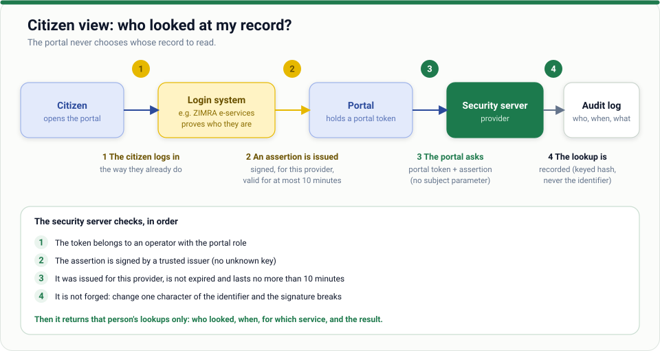

# Citizen guide

*A short guide for anyone who wants to know who has looked at their information.*

## What is Z-Road, for me?

When a bank, a company or a government office checks something about you with another office (for
example, whether your tax is up to date), the question and the answer travel over Z-Road. **Each one is
recorded**, and the office holding the data can show you the record.

## What you can see

For each time your information was looked up:

- **Who** looked (the organisation)
- **When**
- **Which service** (for example, "tax clearance check")
- **The result** (answered, refused, and so on)

You are not shown the data itself, nor the internal details of the organisation's systems.

## How to look

Where an office offers an **access-log page**, you log in the way you normally do for that office (for
example, your taxpayer account), and the page lists the lookups about you, newest first. Which offices
offer this is up to each office and is being introduced step by step.

## Your rights and what to do

| If you see | You can |
| --- | --- |
| A lookup you expected | Nothing; this is normal |
| A lookup you do not recognise | Ask the office that holds the record why it was made. Your data-protection authority can help if you do not get an answer |
| A mistake in your data | Ask the office holding it to correct it |

## Your privacy

- The page can show **only your own** record, proved by the login you just did. It cannot be made to show someone else's.
- The proof lasts minutes, not days.
- Nobody, including the portal, can read your record by guessing numbers.

## Questions

Ask the office that runs the page, or the authority responsible for Z-Road in your country.

[← All guides](../README.md)
