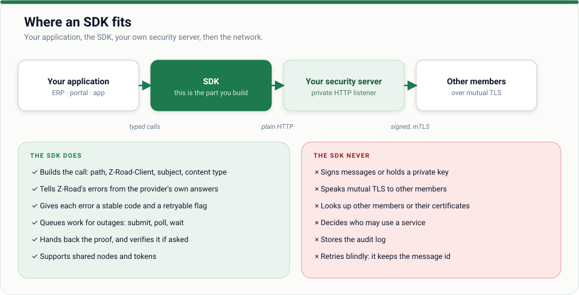

# Consumer developer guide

*You write an application (ERP, accounting package, bank system, portal) that needs an answer from
another organisation's service. You do **not** need to know cryptography.*



## The idea in one minute

Your application makes an ordinary **HTTP call to your own organisation's security server**. It signs,
secures, logs and delivers the call, and returns the provider's answer plus a **proof**. You never
handle keys or certificates.

## What you need from your IT team

| Item | Example |
| --- | --- |
| Your security server's internal address | `http://10.0.0.5:7002` |
| Your **client id**: your member id plus a subsystem name | `ZW/COM/12345678/accounts-payable` |
| An internal token, if your server requires one | `Authorization: Bearer …` |
| The service you want | `ZW/GOV/ZIMRA/tax-clearance/verify/v1` |

Your organisation must already be a member with a security server ([provider](provider.md) steps 1 to 5
apply; a pure consumer has no `[[services]]`). Find services with
`zroad-cli catalogue --central … --ca ca.pem --schemas`.

## Your first call

```sh
curl -si -X POST http://10.0.0.5:7002/r1/ZW/GOV/ZIMRA/tax-clearance/verify/v1 \
  -H 'Z-Road-Client: ZW/COM/12345678/accounts-payable' \
  -H 'Z-Road-Subject: 2000123456' \
  -H 'Authorization: Bearer <internal token>' \
  -H 'Content-Type: application/json' \
  -d '{"tin":"2000123456"}'
```

You get the provider's answer, with its own status code, and these headers:

| Header | Meaning |
| --- | --- |
| `Z-Road-Message-Id` | The id of this exchange. Keep it |
| `Z-Road-Proof` | Signed evidence of request and answer. Keep it with your decision |
| `Z-Road-Error` | **Only** present when Z-Road itself failed; see below |

## Using a library

**Python** ([z-road-python](https://github.com/phoscoder/z-road-python))

```python
from zroad_client import Client, ZRoadError, Unreachable

zroad = Client("http://10.0.0.5:7002", "ZW/COM/12345678/accounts-payable", token="…")
try:
    reply = zroad.call("ZW/GOV/ZIMRA/tax-clearance/verify/v1", {"tin": "2000123456"}, subject="2000123456")
except ZRoadError as e:
    print(e.code, e.retryable)
except Unreachable:
    print("our security server is down")
else:
    ok = reply.ok and reply.json()["status"] == "VALID"
```

**Rust**: `crates/zroad-client` (see [integration](../../docs/integration.md)).
**Other languages**: plain HTTP as above, or [write an SDK](../04-sdk-development.md).

## Handling results: three outcomes

| You see | It means | You do |
| --- | --- | --- |
| Normal response, any status, no `Z-Road-Error` | The provider answered (even "404 not found") | Use the answer. Store the proof |
| `Z-Road-Error: <code>` | Z-Road refused or failed | Look at `code`; retry only if `Retry-After` is present |
| Cannot connect to your own server | Your security server is down | Alert your IT team |

Common codes: `access_denied` (not allowed: ask the provider, do not retry), `schema_violation` (fix your
request), `unknown_provider`, `provider_unreachable` (retry), `rate_limited` (back off). Full list:
[troubleshooting](../07-troubleshooting.md).

## When the provider may be down: queue it

```sh
curl -s -X POST …/r1/ZW/GOV/ZIMRA/tax-clearance/verify/v1 \
  -H 'Z-Road-Mode: async' -H 'Z-Road-Client: ZW/COM/12345678/accounts-payable' \
  -d '{"tin":"2000123456"}'
# → 202 {"message_id":"…","status_url":"/internal/v1/outbox/…"}

curl -s http://10.0.0.5:7002/internal/v1/outbox/<message_id>
```

Your security server keeps the request on disk and retries with growing pauses. Use it for batch
jobs, payment runs, and anything that must survive an outage or a restart. Use synchronous calls for
screens a person is waiting on.

## Good habits

- **Store the proof** beside every decision made on the answer. It is your evidence later.
- **Send the subject** (`Z-Road-Subject`) when the query is about a person or company, so the access log can tell them.
- **Validate against the service's schema** in your tests.
- **Do not log** tokens or personal data. Log the message id.
- **Never call a provider directly.** Always go through your own security server.
- **Do not auto-retry** calls that have side effects; use the queue.

## Try it without a real network

```sh
scripts/demo.sh        # starts a full local network; see the quickstart
```

[01 · Quickstart](../01-quickstart.md) walks through it.

[← All guides](../README.md) · [SDK development](../04-sdk-development.md)
