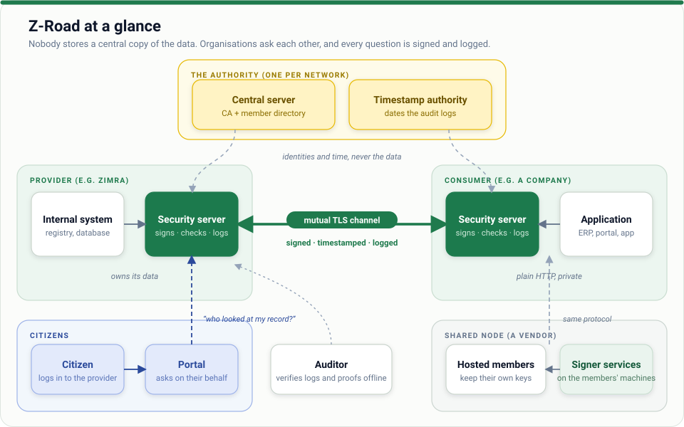

# Decision-maker guide

*For ministers, permanent secretaries, directors, regulators, funders and procurement officers.
No technical background needed.*

## What it is

Z-Road is a secure way for government bodies and companies to **ask each other questions** (for
example, "does this company's tax clearance stand?") **without sharing databases**.

- Each organisation keeps its own data, on its own systems.
- Each question and answer is **signed**, **time-stamped** and **recorded** by both sides.
- Either side can later **prove** what was asked and answered, and nobody can quietly change history.
- The organisation that owns the data decides **who may ask what**.

It copies the idea behind Estonia's X-Road, which has run a national data-exchange layer for over twenty years.

## What it gives you

| Benefit | What it means in practice |
| --- | --- |
| **Fewer paper certificates** | A bank checks a company's tax standing directly instead of asking for a stamped letter |
| **Accountability** | Every access leaves a trail; a citizen can ask who looked at their record |
| **Data stays put** | No central database of everything. A breach at one agency does not expose the rest |
| **Lower integration cost** | One way to connect, instead of a separate arrangement per pair of organisations |
| **Trust by maths, not by paperwork** | Signatures and timestamps can be checked by anyone, later |

## What it does not do

- It does not decide **who is entitled** to data. Laws, agreements and each provider's rules do that.
- It does not make a poor source of data accurate.
- It does not replace data-protection law; it makes compliance easier to show.

## What you need to decide

| Decision | Options | Guidance |
| --- | --- | --- |
| **Who is the authority?** | A ministry, an ICT agency, a regulator | Needs a legal mandate and a team that will run it for years |
| **Which services first?** | Tax clearance, company registry, vehicle registry | Start with one with clear demand and one willing provider |
| **Who may join?** | Government only, or companies and banks too | Start narrow, widen with experience |
| **Citizen access** | Yes or no | Strongly recommended: it is how the public sees accountability |
| **Hosting** | Each organisation runs its own, or shared nodes for small ones | Offer both; small bodies cannot run servers |
| **Legal basis** | Law, regulation, data-sharing agreements | Needs your lawyers. See [legal considerations](../../docs/legal-considerations.md) |

## Risks to know about

- **It is only as strong as its key custody.** Today the authority's key is protected by file permissions and procedure; hardware protection is on the [roadmap](../../ROADMAP.md).
- **It has not been independently audited.** Commission a review before real citizen data flows.
- **People matter more than software.** Operators, procedures and incident response decide whether it is safe: see [security checklist](../08-security-checklist.md).

## What a sensible start looks like

The [pilot plan](../../docs/pilot-plan.md): one authority, two or three organisations, one service,
fake data first, then real data under agreement, with success measured (time saved, certificates
avoided, incidents). The [roadmap](../../ROADMAP.md) shows what is built and what remains.

## Questions to ask your team

1. Who will run the authority, and who covers them when they are away?
2. What law lets us share this data, and what does it forbid?
3. Who reviews the system independently before go-live?
4. What happens when something goes wrong? (Ask to see the [incident guide](../06-incident-response.md).)
5. How will a citizen find out who looked at their data?

[← All guides](../README.md) · Next: [How Z-Road works](../00-concepts.md)
