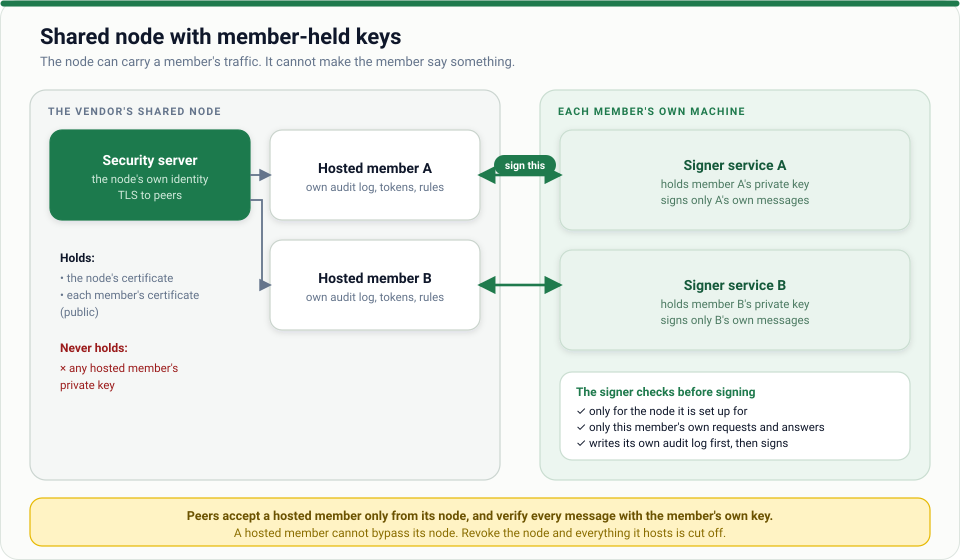

# Node operator guide

*You are a vendor, bureau or agency that runs one security server on behalf of several smaller
organisations. You carry their traffic; you may or may not hold their keys.*



## Choose a mode

| Mode | Who holds each member's key | Use when |
| --- | --- | --- |
| **Operator-held** | You | The law and contracts say you act as the member. Simplest. **You can sign as them**, so protect that |
| **Member-held** (recommended) | The member, in a signer service on their machine | You want to carry traffic without being able to sign as anyone |

You can mix modes on one node. Providers refuse a hosted member that tries to connect directly
(`hosted_member_must_use_node`), so a node is the only road in.

## Setting up a member-held node

1. **Your own identity.** The authority registers the node as a member (`ZW/NODE/<name>`, with your endpoint) and you enrol it like any security server ([02 · Deploy securely](../02-deploy-securely.md) §4). Its key lives in your `node_data_dir`.
2. **Register each hosted member** (the authority does this, with `--hosted-by ZW/NODE/<name>`). They enrol on their own machines and send you `cert.pem`, `ca.pem`, `signer-ca.pem` ([hosted member guide](hosted-member.md)).
3. **Put each member in the node file**:

   ```toml
   node_member   = "ZW/NODE/acme-hosting"
   node_data_dir = "node-identity"          # key.pem, cert.pem, ca.pem of the node itself

   [[members]]
   member_id   = "ZW/COM/11111111"
   data_dir    = "acme"                      # cert.pem + ca.pem ONLY; startup refuses if key.pem is here
   admin_token = "a-long-random-token-for-acme"
   remote_signer = { url = "https://signer.acme.example:9443", ca_file = "acme-signer-ca.pem" }
   ```
4. `security-server check-config --config …` then start. Each member gets their own audit log and state.

Their applications use the prefix `/m/<instance>/<class>/<code>/` on your internal address, with
**their own** token, so one member can never act as another.

## What you are responsible for

| Duty | Notes |
| --- | --- |
| Keep the node up and patched | Their calls stop if you do |
| Keep each member's logs and offer them an export | They must be able to leave with their history |
| Keep tokens separate | One `admin_token` per member |
| Tell members promptly about incidents | You can see their traffic |
| Never hold what you need not | For member-held keys, refuse to accept a `key.pem` |

## What to tell your customers

Say plainly: you can see their requests and answers in transit and keep logs, but you cannot sign as
them (member-held) or you can (operator-held). Put it in the contract with the liability that follows.

## Routine and incidents

[Operations runbook](../05-operations-runbook.md) and
[incident response](../06-incident-response.md) apply to the node. Extra items:

- A member's signer goes down → that member's calls fail with `signer_unavailable`; others are unaffected.
- A member leaves → remove their `[[members]]` block and restart; give them their log export.
- The node is compromised → every hosted member's traffic was exposed; tell them all, rotate the node's identity, and review each member's log.

[← All guides](../README.md) · Design notes: [shared-nodes](../../docs/design/shared-nodes.md)
